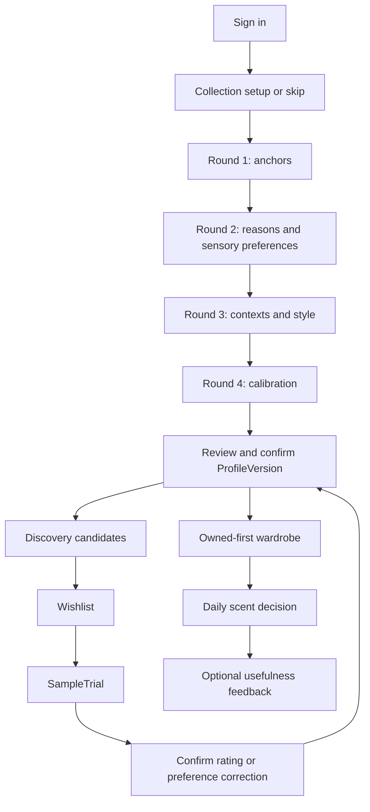

# 03 — Application flow

Version 1.0 · 31 October 2026

Companions: [PRD](01-product-requirements.md), [Technical requirements](02-technical-requirements.md), [Design brief](04-design-brief.md), [Backend schema](05-backend-schema.md), [Implementation plan](06-implementation-plan.md).

## 1. Navigation and route map

Public routes: `/`, `/sign-in`, `/auth/verify`, `/privacy`, `/accessibility`. Authenticated routes:

| Route | Purpose / main action |
|---|---|
| `/home` | Continue consultation, choose today’s scent, review recent trial |
| `/collection` | Find, add, rate, resolve, and manage current/former fragrances |
| `/collection/:itemId` | Ownership, availability, personal rating, evidence and history |
| `/consultations/:id/round/:round` | Guided questions and saved progress |
| `/consultations/:id/review` | Review all four rounds and confirm profile |
| `/profile` | Current stated preferences, hypotheses, context rules and corrections |
| `/discover` | Generate and compare sample candidates |
| `/recommendations/:runId` | Saved result with reasons, uncertainty, provenance and staleness |
| `/fragrances/:id` | Verified identity, available facts, sources and personal relationship |
| `/wardrobe/:planId` | Season/occasion coverage; pin or replace choices |
| `/decide` | Context inputs and up to three currently owned choices |
| `/wishlist` | Prioritized investigation/sample/purchase intent |
| `/samples/:trialId` | Opening, two-hour, six-hour impressions and final feedback |
| `/settings` | AI consent, analytics, export, account deletion |
| `/admin/catalog` | CURATOR-only catalog review and publication |

Primary navigation: Home, Collection, Profile, Wardrobe, Discover. “Choose for today” is always visible as a prominent action. Wishlist/Samples sit in Discover and are directly linkable. On small screens use a compact labelled navigation menu; do not bury save/resume controls.

## 2. First visit and collection setup

1. Landing explains the outcome in one screen: use what you own, learn your preferences, sample thoughtfully. “Start your consultation” leads to sign-in. Explain that AI is optional; do not require its consent to start.
2. Submit email; show a generic acknowledgment and resend cooldown. Verification page requires a button press to consume the single-use link; expired/used links offer a new request.
3. Collection setup offers “Add fragrances” and “Start without a collection.” Search by brand/name. Each result shows concentration/edition text. Confirm exact product before saving.
4. Select OWNED, PREVIOUSLY_OWNED, SAMPLED, or UNKNOWN. Ask whether an owned bottle is available now. Rating is a separate optional control with a visible UNKNOWN option.
5. If no match, save original name as a private unresolved CollectionItem. Show “Needs identification”; do not invent notes, performance, imagery, or an item in the shared catalog. Curator may later resolve; user confirms a suggested identity before their item changes.
6. Collection summary distinguishes “available to wear,” “previously owned,” “sampled,” and “needs clarification.” Continue to round 1 even if unresolved entries exist.

Duplicate identity in the same user’s collection opens the existing item. Never silently merge ratings or overwrite ownership. MVP stores one CollectionItem per user/fragrance, not one row per physical bottle. Wishlist is separate.

## 3. Interview behavior

State machine: `DRAFT → IN_PROGRESS → REVIEW → COMPLETED`; `ABANDONED` is an explicit user action. Round completion is sequential. A user may revisit earlier rounds; editing invalidates downstream summaries and moves a completed consultation back into review work without changing its previous ProfileVersion. A newly confirmed ProfileVersion is a new snapshot.

Each round contains: heading “Round n of 4,” concise purpose, questions, optional comment, autosave status, Back, and Review round. “Skip” means SKIPPED; an unanswered field is UNANSWERED; neither means NEUTRAL. At round review, show “You told us,” “Possible interpretation,” and “One thing to clarify” only when material uncertainty exists. “Continue” acknowledges the summary. No endless AI follow-up loop: maximum two targeted clarifications per round, then preserve uncertainty.

Autosave after 600 ms idle and on navigation; explicit Next awaits server save. Display Saving, Saved, Offline/not saved, or Conflict. Never say Saved before server acknowledgment. Keep only the current tab’s unsaved draft in memory; no persistent browser storage of sensitive free text in MVP. Warn before losing an unsaved draft. On reconnect retry with the current entity version; 409 opens a side-by-side local/server comparison, preserving typed text. User chooses which fields to retain; do not overwrite another tab silently.

### Round 1 — Anchors and motivation

Select or name up to three favorites and rank using accessible Move up/Move down buttons. Dragging may be optional but is never the sole control. Select dislikes and describe what perfume does for the user. Record collection history as mixed/current/former/unknown without mass-setting individual items. Show a provisional summary, such as “Elegance is an explicit goal; a rose preference is not yet established.”

Zero favorites is valid if the user states a usable direction. An unresolved favorite supports its stated emotional reason but contributes no catalog feature inference.

### Round 2 — Reasons, sweetness, presence

Ask why each favorite appeals. Offer understandable sensory and emotional tags plus optional prose. Capture sweetness and general desired presence. Ask what disappointed the user about disliked fragrances. If “synthetic/artificial” appears, record perceived harshness as a subjective dislike; do not infer chemical composition or ingredient avoidance.

If the user selects noticeable presence now, retain it as a general preference. It can later coexist with an office-specific discretion rule. No new perfume shortlist yet.

### Round 3 — Context and wardrobe roles

Capture work/casual style, date character, occasions, desired descriptors, climate, budget, and shared spaces. Use OFFICE, IMPORTANT_MEETING, WEEKEND, DAY_DATE, EVENING_DATE, FORMAL, SPECIAL, GYM as the initial occasion taxonomy. “Dates” may be expanded into day/evening only when the user confirms; otherwise retain a general date preference through a context rule applicable to both.

Offer scoped clarification: “You prefer a noticeable scent generally. Keep it more discreet for commuting and the office?” Options confirm a context override or keep the general preference. Profile review lists both. Body type is not asked. Avoid requesting exact location; four-season climate and manually selected weather are sufficient.

### Round 4 — Calibration

Display compact rating rows for known entries, prefilled from collection ratings. Existing UNKNOWN remains UNKNOWN until changed. Capture clean direction, season flexibility, compliment observations, longevity band, and discovery appetite. Compliments are informational; personal enjoyment takes priority.

At completion, validate essential fields from document 01. Missing optional answers do not block. If taste signals remain insufficient, explain what is missing and let the user complete a limited profile rather than forcing arbitrary ratings.

## 4. Review and profile confirmation

Review shows all structured answers, interpretation proposals, and context overrides. Label each trait STATED, INFERRED, or CONFIRMED with evidence. User can accept/reject inferred traits individually; never require agreement with an archetype. An optional archetype label is editable descriptive copy, not a hidden input to ranking.

“Confirm profile” transaction checks answerRevision, captures collection/rating versions, creates immutable ProfileVersion and evidence links, and marks the consultation COMPLETED. If a competing edit occurred, return 409 and show the changed fields. A provider failure cannot prevent confirmation of deterministic structured answers.

Profile page offers “Why this appears” and “Correct this.” Correction creates a new ProfileVersion with a link to the superseded version. Existing runs/plans become stale; nothing is silently rewritten. CTA: “Refresh recommendations using your updated profile.” Preserve the previous version for inspection until account deletion.

## 5. First results: use the collection, then discover

After confirmation, show three sections:

1. **Your preferences:** concise synthesis, family/accord directions as confirmed or exploratory, performance goals and context rules.
2. **Your wardrobe:** available owned coverage first; clarify missing ownership before suggesting wear-now choices.
3. **What to sample:** up to five verified candidates, separated from current collection choices.

Recommendation cards show identity/concentration, fit reasons, one uncertainty, role, overlap, and provenance. Actions: View details, Save to wishlist, Record sample. Avoid “Buy now” in MVP. Filtering designer/niche or safe/exploratory changes a request snapshot and creates a new run. Always show active constraints. No result is preferable to an unsupported recommendation.

Possible outcomes:

| State | UI response |
|---|---|
| MATCHES | Ranked choices with explanations and clear owned/explore status |
| NO_MATCH | Explain binding exclusions; offer user-controlled constraint edits |
| INSUFFICIENT_EVIDENCE | Show missing evidence and suggest rating/testing; limited exploratory candidates only with explicit choice |
| NO_FRAGRANCE | Explain the venue constraint and stop recommendation generation |
| Provider unavailable | Show the same deterministic recommendations and template explanations |
| Catalog withdrawn | Keep historical record but suppress active recommendation actions and explain withdrawal |
| Stale profile/collection | Label saved results and offer refresh; never describe them as current |

## 6. Wardrobe generation and editing

User chooses seasons and occasions; default only to their previously selected occasions. Create up to 32 slots (four seasons × eight occasions). Weather can override a seasonal guideline in the daily decision, not mutate the entire plan.

Desktop: season columns and occasion rows. Small screens: occasion sections with season cards. Each slot shows up to three available owned choices, fit reason, and uncertainty. Pin a favorite to retain it through refresh. Pinning does not bypass fragrance-free rules or availability checks; a formerly owned item becomes an unavailable pinned reference until replaced.

“Gap” means no sufficiently supported owned option meets the slot, or available evidence is weak. Explain the difference. “Explore this role” opens Discover with the slot context. Overlap opens a comparison showing shared occasions and meaningful differences; no automatic decluttering action.

Regeneration creates a new WardrobePlan revision linked to its predecessor and copies valid pins. User edits update slot versions within that plan; generation snapshots and their run IDs remain immutable. Preview changed assignments before replacing the active plan pointer.

## 7. Daily scent decision

1. Open Choose for today.
2. Select a ContextPreset or enter season/weather, occasion, outfit, desired presence, shared-space status, and fragrance-free status. Optional longevity override. No location permission.
3. Review constraints; a preset shows its name and overridden fields.
4. Submit. For fragrance-free venue, return NO_FRAGRANCE immediately. Otherwise rank only resolved, available OWNED items.
5. Show a primary choice and up to two alternatives, with “why today” and uncertainty. Qualitative application guidance may say “keep application restrained and reassess at conversational distance”; do not promise a spray count achieves a certain exposure.
6. User may record “Wore this” and optional usefulness feedback. A choice is not a new LOVE rating. Explicit trial/rating actions are separate.

If the user owns nothing eligible, offer to clarify the collection or browse samples; do not pass a wishlist item off as available. A dinner after a commute can be represented by the stricter shared-space cap or two explicit decisions. Never silently ignore the commute to optimize evening presence.

## 8. Wishlist and sampling loop

Wishlist states: CONSIDERING → WANT_TO_SAMPLE → SAMPLING → DECIDING → PURCHASED or DISMISSED. User may move backward; the app does not infer a purchase from elapsed time. PURCHASED prompts explicit confirmation to create/update CollectionItem as OWNED and available. Refusing confirmation leaves wishlist purchase intent/history alone.

Start SampleTrial from a candidate or catalog detail. Record actual start time and context. Observation checkpoints are OPENING, TWO_HOURS, SIX_HOURS; record actual elapsed minutes, since a late entry must not pretend to be exactly two hours. Each checkpoint captures free text, perceived presence, enjoyment, and whether the user could still detect it. Optional outfit/context fit and compliments remain subjective observations.

No push/email reminders in MVP. In-app “next observation due” is advisory. Skipped observations remain empty. Completing a trial prompts a separate overall PreferenceRating confirmation. If accepted, append a rating revision, create a new ProfileVersion with deterministic recalculation, and mark dependent results stale. Never label a fragrance as universally long-lasting based on one person’s trial; user observations are private evidence.

## 9. Settings, export, deletion, and recovery

AI consent explains which minimized fields leave the service. Toggling off cancels queued provider jobs and leaves core features available. Analytics consent is separate. Export requires recent sign-in and produces a versioned JSON file plus readable Markdown summary in a ZIP, covering owned/former/unresolved items, answers, profile history, runs, wardrobe, wishlist, trials, settings, and evidence references. Catalog excerpts may be limited by license; include IDs/URLs and the user’s own data.

Deletion requires recent sign-in, a plain-language consequence screen, and typing DELETE. Show the concrete retention timeline from document 02. On acceptance revoke sessions immediately, return a receipt, and prevent further writes. A deletion receipt should not imply a still-authenticated job-status page; a generic completion email may be an explicitly consented transactional message. Product notification delivery is implementation scope, not permission for this document-writing task to send messages.

If an export fails, allow retry without duplicating work. If deletion fails, operator alert and retry retain the deletion lock. Network failure after a successful mutation is recovered using the same idempotency key. Session expiry retains current tab draft long enough to sign in and retry, then clears it on explicit logout.

## 10. Curator workflow

Curator creates draft → confirms exact identity/edition → adds approved SourceRecords and field-level CatalogClaims → reviews conflicts/missing fields → publishes immutable CatalogRevision and CatalogRelease. Missing performance data remains missing. No automatic promotion of an unresolved user entry into a shared catalog item. User text cannot inject instructions into curation.

Withdrawal immediately blocks new recommendations; previous run details display a warning. New revisions create new releases without changing historical run facts. Curator audit trail records actor, operation, object ID, timestamp and reason, excluding unrelated user data.
